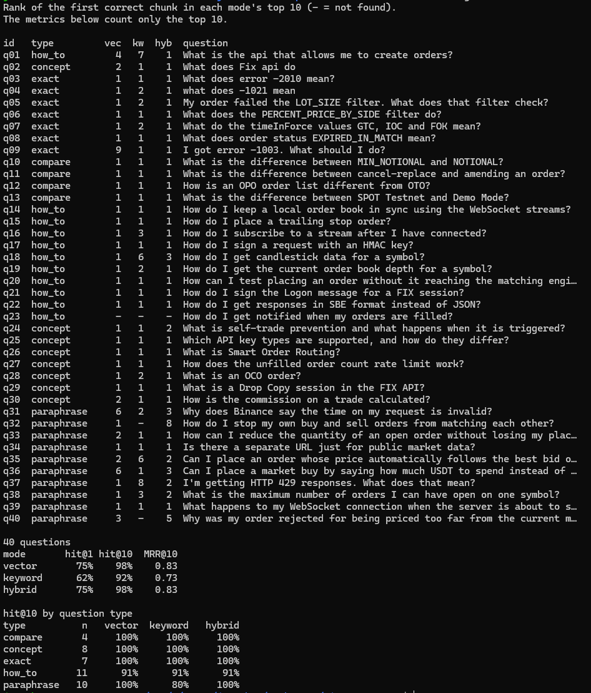

# Binance API RAG

A question-answering assistant over [Binance's Spot API documentation](https://github.com/binance/binance-spot-api-docs). It finds the relevant doc sections with **hybrid search** (vector search with pgvector plus Postgres full-text search, merged with Reciprocal Rank Fusion) and answers with **citations** that link to the exact section on GitHub.

Stack: Python 3.12, PostgreSQL 17 + pgvector (Docker), OpenAI embeddings and chat models, uv, pytest.


## Example

```
$ uv run rag ask "what does -1021 mean"
-1021 INVALID_TIMESTAMP — "Timestamp for this request is outside of the recvWindow."
Possible cause: "Timestamp for this request was 1000ms ahead of the server's time." [1]

Sources:
[1] errors.md > Error codes for Binance > 10xx - General Server or Network issues > -1021 INVALID_TIMESTAMP
    https://github.com/binance/binance-spot-api-docs/blob/f0ee79c.../errors.md#-1021-invalid_timestamp
```

Exact strings like error codes are where hybrid search helps: vector search alone ranks the neighbouring codes -1020 and -1022 almost as high as -1021, while keyword search matches `-1021` exactly.

## How it works

```
INGEST (once)
  docs repo @ pinned commit → English Markdown files
    → chunk by heading (strip TOC, keep code blocks whole, split long sections)
    → embed each chunk (OpenAI text-embedding-3-small)
    → Postgres: text + vector + full-text index

QUERY
  question ─┬→ embed → vector search (top 20) ─────┐
            └→ full-text keyword search (top 20) ──┴→ merge (RRF) → top 5 chunks
            → LLM answers from those chunks only, citing them

EVAL (rag eval)
  40 questions with known correct sections → hit@k and MRR, per search mode
```


### Retrieval and answers

| Step | How it works |
|---|---|
| **Vector search** | The question is embedded with the same model as the chunks. The 20 chunks with the smallest cosine distance (pgvector's `<=>`) are returned. |
| **Keyword search** | The question goes through `plainto_tsquery('english', …)`, which drops stopwords and stems the rest, and its words are joined with OR. Chunks are matched against the stored `tsv` column (GIN index) and ranked with `ts_rank`, with heading words weighted above body words. Top 20. |
| **Fusion** | Reciprocal Rank Fusion: each chunk scores the sum of `1 / (60 + rank)` over the two lists, so a chunk found by both searches beats one found by only one. The top 5 go to the answer step. |
| **Answer** | The LLM (`ANSWER_MODEL`, default `gpt-5-mini`) gets the 5 chunks numbered `[1]`–`[5]`, with instructions to answer only from them and cite them by number. The CLI then prints a link for each cited section. |

## Evaluation

`uv run rag eval` runs every question in [`eval/questions.jsonl`](eval/questions.jsonl) through all three search modes and records the rank of the first chunk from a correct section.

- **Labels.** Each question lists the doc sections that answer it, as a file plus one heading title. A chunk counts as correct if it is in that section or one of its subsections. When all three APIs cover the topic (e.g. placing an order), the REST, WebSocket and FIX sections are all listed.
- **hit@k**: the share of questions with a correct chunk in the top k. hit@5 matters most, because the answer step reads the top 5.
- **MRR@5**: the mean of 1/rank of the first correct chunk, counting 0 when none is in the top 5. It rewards ranking the answer first, not just somewhere in the top 5. Both metrics use the same k because the answer step never sees rank 6. The per-question table still shows ranks up to 10, so a near miss is visible.

Results on 2026-10-23 (40 questions, docs at commit `f0ee79c`, `text-embedding-3-small`):



What the numbers show:

- **Hybrid gets more answers into the top 5, but doesn't rank them first more often.** hit@5 rises from 90% to 95% and MRR@5 only from 0.81 to 0.83, while hit@1 is the same. Hybrid moves 7 questions up and 6 down, and the gains and losses nearly cancel out.
- **Keyword search rescues exact identifiers.** "I got error -1003. What should I do?" is rank 9 in vector search and rank 1 in hybrid.
- **Hybrid can also hurt.** "How do I stop my own buy and sell orders from matching each other?" is rank 1 in vector search but rank 8 in hybrid. Its common words ("stop", "buy", "sell", "order") match the trailing stop FAQ, which vector search also has in its top 20, so RRF ranks those chunks above self-trade prevention.
- **All three modes miss "How do I get notified when my orders are filled?"** The word "filled" pulls in the *unfilled* order count FAQ instead of the user data stream's execution report.


## Setup

Requirements: Docker, [uv](https://docs.astral.sh/uv/), git.

```bash
cp .env.example .env          # then add your OPENAI_API_KEY
docker compose up -d          # Postgres + pgvector on localhost:5433
uv sync                       # install dependencies
uv run rag fetch-docs         # download the docs at the pinned commit
uv run rag init-db            # create the table and indexes
uv run rag ingest             # chunk, embed and store the docs (about US$0.005)
uv run rag ask "How do I place a new order?"
```

## Commands

| Command | What it does | API cost |
|---|---|---|
| `uv run rag fetch-docs` | Download the docs at the pinned commit | none |
| `uv run rag chunks --stats` | Chunk all docs and print statistics | none |
| `uv run rag chunks --file filters.md` | Print the chunks for one file | none |
| `uv run rag ingest` | Chunk, embed and store everything (replaces existing rows) | ~244k tokens ≈ US$0.005 at $0.02 per 1M tokens (Oct 2026) |
| `uv run rag init-db --reset` | Drop and recreate the table, deleting all chunks. Needed after changing `EMBEDDING_DIMS` | none |
| `uv run rag search "your question"` | Search the docs and list the top sections (`--mode` hybrid, vector or keyword; `-k` results) | one tiny embedding call (hybrid and vector modes) |
| `uv run rag ask "your question"` | Answer from the top 5 chunks (`--mode` and `-k` as for `search`), citing them, with links to each cited section | one embedding call + one `ANSWER_MODEL` call |
| `uv run rag eval` | Run the retrieval eval: per-question ranks in each search mode, then hit@1, hit@5 and MRR (`--questions` for another file) | one embedding call for all questions |
| `uv run pytest` | Run the tests: chunking rules, the answer step (with a fake LLM), and the eval's matching and metrics | none |

Set `EMBEDDING_PROVIDER=fake` in `.env` to run `ingest` offline with meaningless vectors, which is useful for testing the pipeline without spending anything.

## Design decisions

- **English docs only, pinned to one commit**, so chunk counts, citations and eval results are reproducible.
- **Chunk by heading.** Each section of the docs is one topic. Every chunk carries its heading path (e.g. `Filters > Symbol filters > LOT_SIZE`), which is embedded along with the text. 
- **Upper bound for chunk size** Sections over ~800 tokens are split at blank lines outside code blocks, so code examples and tables stay whole. The 25 files give 708 chunks.
- **Headings weighted higher in full-text search**, since error codes and filter names usually appear in headings.
- **Keyword search matches any word, not every word.**
- **Fuse by rank, not by score.** Cosine similarity and `ts_rank` are on different scales, so adding the scores would favour whichever runs larger.
- **Swappable LLM.** The answer step talks to a small `LLM` interface, so another provider can replace OpenAI without changing the rest. The tests use a fake LLM and cost nothing.
- **Eval labels name sections, not chunks.** Chunk ids change on every re-ingest, and a long section is split into several chunks, so a label is a file plus a heading. Any chunk of that section counts.

## Known limitations

- **`ts_rank` has no IDF.** A rare term like `-1021` counts no more than a common word like "mean", so **keyword** search alone ranks FAQs titled "What does that field mean?" above the -1021 section. Hybrid search recovers here because vector search ranks -1021 first. A BM25 extension (such as ParadeDB's `pg_search`) would fix it at the source.
- **Common words can outvote vector search in RRF.** A chunk that both searches find gets points from both lists, even when keyword search matched it only on generic words like "order". See the self-trade prevention example under [Evaluation](#evaluation).
- **Parts of one long section compete for the top 5.** For "How do I place a new order?", 3 of the 5 hybrid results are parts of the WebSocket "Place new order" section, and the REST endpoint `POST /api/v3/order` drops out, so the answer only covers WebSocket.
